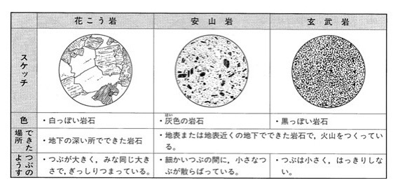

# hass-marklife

<!-- hass-standards:badges:start -->
[](#설치)
[](https://github.com/eigger/hass-marklife/releases)
[](hacs.json)
[](https://github.com/eigger/hass-marklife/actions/workflows/tests.yml)
[](https://github.com/eigger/hass-marklife/actions/workflows/validate.yml)
[](LICENSE)
[](https://analytics.home-assistant.io/)
<!-- hass-standards:badges:end -->

[English](README.md) | **한국어**

Home Assistant의 자체 블루투스 스택 및 ESPHome 블루투스 프록시를 통해 Marklife 블루투스 감열 라벨 프린터(P15, P12, M60, P50 및 호환 모델)를 제어하고, [imagespec](https://github.com/eigger/imagespec) 선언형 레이아웃을 통해 라벨을 인쇄하는 HACS 커스텀 통합 구성요소입니다.

## 갤러리

| P15 |
| :---: |
|  |

## 지원 기기

- **동작 검증 완료**: **Marklife P15** (L11 프로토콜 제품군, 384 px 헤드 폭) — 로컬 블루투스 어댑터 및 ESPHome 프록시 지원.
- **호환 제품군**: P12, P11, P7, P1s, M1, M60, X2, P50 및 관련 BLE 모델.
- **미지원 기기**: 블루투스 클래식(Classic) 전용 모델(S8, D210, HM-24-28 등) 및 독자 비공개 프로토콜 모델(D100, X4).
- 전체 모델 목록 및 사양은 [사용자 가이드](docs/ko/user-guide.md#지원-모델)를 참고하세요.

## 요구사항

- Home Assistant **2025.1.0** 이상.
- 동작 가능한 블루투스 어댑터 또는 활성 연결이 켜진 [ESPHome 블루투스 프록시](https://github.com/eigger/hass-repo-standards/blob/main/docs/bluetooth.ko.md) (`bluetooth_proxy: active: true`).
- 지원되는 Marklife BLE 라벨 프린터 (인쇄 전 스마트폰 앱 연결 해제 필요).

## 설치

1. **HACS → 통합(Integrations)**에서 **Marklife**를 검색하여 다운로드하거나, `custom_components/marklife/` 폴더를 Home Assistant의 `custom_components/` 디렉터리에 복사합니다.
2. Home Assistant를 다시 시작합니다.
3. **설정 → 기기 및 서비스**에서 자동으로 검색된 프린터를 확인하거나, **통합 추가 → Marklife**를 선택합니다 (자동 검색이 되지 않는 경우 수동 주소/모델 선택 단계로 진행됩니다).

ESPHome 프록시 보드 추천(XIAO W5500 V1.2, M5Stack AtomS3U 등) 및 설정 방법은 [블루투스 프록시 안내](https://github.com/eigger/hass-repo-standards/blob/main/docs/bluetooth.ko.md)를 참고하세요.

## 빠른 시작

`marklife.print` 액션으로 기본 라벨을 인쇄할 수 있습니다:

```yaml
action: marklife.print
target:
  device_id: <기기 ID>
data:
  payload:
    - type: text
      value: "안녕하세요!"
      font: ppb.ttf
      x: 10
      y: 10
      size: 40
    - type: qrcode
      data: "https://www.home-assistant.io"
      x: 270
      y: 10
      width: 80
      height: 80
  width: 384
  height: 96
```

## 중요 제한사항

- **단일 연결 제한**: 감열 프린터는 한 번에 하나의 블루투스 연결만 수락합니다. 인쇄 전 스마트폰 앱(Marklife) 연결을 반드시 종료해야 합니다.
- **클래식 블루투스 및 독자 규격 미지원**: 블루투스 클래식이나 독자 프로토콜을 사용하는 기기는 BLE로 제어할 수 없으며 검색 시 거부됩니다.
- **프록시 슬롯 제약**: ESP32 프록시는 동시 연결을 최대 3개까지만 지원합니다. 슬롯 고갈에 유의하세요.

## 관련 문서

- [사용자 가이드](docs/ko/user-guide.md) — 전체 모델 목록, 상세 옵션, 엔티티, 출력 방향 안내 및 `imagespec` 서식 예제.
- [문제 해결](docs/ko/troubleshooting.md) — 흐름 제어(Credit starvation) 튜닝, 패킷 크기 조정, 연결 오류 점검 및 로그 보고 방법.
- [개발 및 테스트](docs/development.md) — 통합 구조, 실제 Home Assistant 테스트 환경 및 표준 채택 안내.
- [블루투스 프록시 가이드](https://github.com/eigger/hass-repo-standards/blob/main/docs/bluetooth.ko.md) — 공통 하드웨어 및 ESPHome 프록시 설정 가이드.

## 지원 및 문의

- 버그 제보 및 신규 모델 지원 요청: [GitHub Issues](https://github.com/eigger/hass-marklife/issues).
- 일반 문의 및 서식 공유: [GitHub Discussions](https://github.com/eigger/hass-marklife/discussions).

## 라이선스

- [MIT License](LICENSE)에 따라 배포됩니다.
- 프로토콜 코어는 [tomLadder/thermoprint](https://github.com/tomLadder/thermoprint) (MIT)를 기반으로 이식되었습니다.
- 라벨 렌더링을 위한 기본 폰트 `ppb.ttf`가 내장되어 있습니다.
